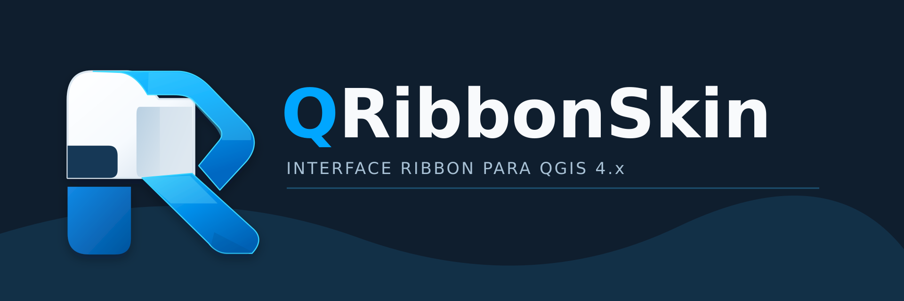

# QRibbonSkin

**Uma interface Ribbon para o QGIS 4.x, organizada a partir das ferramentas nativas do próprio QGIS.**

**Versão estável: 1.1.30.** [Baixar release v1.1.30](https://github.com/ezrandrade/QRibbonSkin/releases/tag/v1.1.30). Identidade visual própria baseada no símbolo **R**, com ícones específicos para o catálogo de complementos e para a ativação do plugin.

O **QRibbonSkin** reorganiza o acesso aos comandos do QGIS em guias e grupos de ferramentas. A interface é reversível e conserva as ações e os algoritmos originais do QGIS: o complemento não substitui mecanismos de geoprocessamento, não altera os dados cartográficos nem introduz novos algoritmos de análise espacial.

O projeto também adapta a apresentação do **Editor de Layout**, do **Georreferenciador** e do **Designer de Modelos (Model Designer)**, oferece uma página de projetos e disponibiliza recursos para recuperar a interface clássica.

> **Importante:** o QRibbonSkin é um projeto próprio, com identidade e funcionalidades documentadas aqui. Os créditos relativos a recursos derivados estão registrados em [ATTRIBUTION.md](ATTRIBUTION.md). As descrições abaixo tratam exclusivamente do QRibbonSkin.

## Visão geral

A faixa de ferramentas distribui funções por atividade, mantendo o mapa e os painéis nativos do QGIS no ambiente de trabalho. As capturas produzidas no QGIS mostram uma organização em guias como **Projeto**, **Principal**, **Editar**, **Exibir**, **Camada**, **Configurações**, **Complementos**, **Vetor**, **Raster**, **Ajuda** e **Interface**, além de outros menus nativos disponíveis na instalação.

As guias derivadas dos menus do QGIS podem refletir os complementos instalados e a configuração do ambiente; por isso, a lista e o conteúdo exibidos podem variar entre instalações.

### Principais recursos

- **Guias e grupos de comandos:** ferramentas reunidas por finalidade, com botões e menus suspensos associados às ações originais do QGIS.
- **Guia Principal:** acesso a criação e adição de camadas, navegação do mapa, seleção e identificação de feições, medições, tabela de atributos, caixa de ferramentas e layouts.
- **Barra de acesso rápido:** comandos frequentes disponíveis independentemente da guia selecionada.
- **Busca de ferramentas:** campo de pesquisa e acesso pelo atalho **Alt+Q**.
- **Página Projeto:** acesso a comandos nativos de novo projeto, abertura, salvamento e projetos recentes, além de informações do projeto atual.
- **Integração com complementos:** apresentação de comandos disponibilizados pelos menus do QGIS e atualização da faixa após alterações nos plugins.
- **Editor de Layout, Georreferenciador e Designer de Modelos:** interfaces adaptadas para esses ambientes do QGIS.
- **Idiomas:** textos do complemento em **português brasileiro** e **inglês**, seguindo o idioma da interface do QGIS.
- **Reversibilidade e recuperação:** opção de restaurar a interface clássica, recuperar barras e painéis e utilizar atalho de recuperação.
- **Apresentação ajustável:** opção de **Modo compacto** e organização em guias com rolagem quando necessário.

## Conhecendo a interface

### Projeto

A guia **Projeto** abre uma página integrada à área do mapa para operações de gerenciamento. Ela apresenta os comandos de **Novo**, **Abrir**, **Salvar** e **Salvar como**, uma entrada para **Projetos recentes** e informações do projeto atual, como nome, localização do arquivo e quantidade de camadas.

A página funciona como uma apresentação temporária sobre a área do mapa. Seu código não substitui o canvas cartográfico nem os dados do projeto. O comando **Voltar ao mapa** retorna à visualização do trabalho.

### Principal

Concentra operações frequentemente utilizadas no trabalho cartográfico:

- criação e adição de camadas;
- deslocamento, aproximação e afastamento do mapa;
- visualização da extensão do projeto;
- edição e seleção de feições por comandos disponíveis;
- medição de linhas e áreas;
- identificação de feições e acesso à tabela de atributos;
- acesso ao Georreferenciador, à Caixa de Ferramentas e aos layouts.

Os botões dependem das ações disponibilizadas pelo QGIS e de seu estado atual. Ferramentas de edição, por exemplo, podem estar indisponíveis enquanto não houver uma camada compatível em edição.

### Editar

Agrupa os comandos de edição disponíveis na instalação, incluindo operações da área de transferência, criação de feições, anotações, edição de atributos e geometria. A disponibilidade de cada ação depende das camadas e das condições de edição do projeto.

### Exibir

Reúne comandos de visualização do QGIS, como vistas de mapa, recursos de visualização 3D, controlador temporal, perfis de elevação, decorações, visibilidade das camadas, painéis e barras de ferramentas, conforme as ações encontradas no menu nativo.

### Camada

Apresenta comandos relacionados às camadas, incluindo fontes de dados, agrupamento, edição, salvamento de alterações e outras ações do menu nativo do QGIS.

### Configurações

Organiza os recursos nativos de configuração acessíveis no QGIS, como perfis de usuário, gerenciamento de estilos, projeções, atalhos de teclado e opções.

### Complementos, Vetor, Raster e outros menus

As guias relacionadas a **Complementos**, **Vetor**, **Raster** e aos demais menus do QGIS refletem as ações disponibilizadas na instalação. Isso permite acessar ferramentas fornecidas pelo QGIS e por plugins habilitados, sem reimplementar seus algoritmos.

Na guia **Raster**, por exemplo, as capturas mostram comandos de complementos instalados ao lado de ferramentas nativas. Esses complementos **não fazem parte da distribuição do QRibbonSkin** e continuam sujeitos à própria instalação, versão e licença.

### Ajuda

Mantém acesso a ferramentas de ajuda e documentação disponibilizadas pelo QGIS e seus complementos.

### Interface

A guia **Interface** reúne ações de controle da apresentação, entre elas:

| Comando | Finalidade |
| --- | --- |
| **Interface clássica** | Desativar a apresentação Ribbon e retornar à interface nativa do QGIS. |
| **Mapa em foco** | Priorizar visualmente a área cartográfica. |
| **Restaurar painéis iniciais** | Recuperar a apresentação dos painéis por meio do comando do plugin. |
| **Personalização da Interface** | Acessar opções de personalização disponibilizadas pelo plugin. |
| **Atualizar menus** | Reconstituir os menus da Ribbon após instalar ou remover complementos. |
| **Modo compacto** | Utilizar uma apresentação mais compacta da interface. |
| **Barras de plugins** e **Menus originais** | Acessar as opções correspondentes de apresentação e menus. |

A nomenclatura pode variar conforme o idioma escolhido.

## Editor de Layout, Georreferenciador e Designer de Modelos

O QRibbonSkin contém módulos específicos para adaptar os comandos e a apresentação das janelas do **Editor de Layout**, do **Georreferenciador** e do **Designer de Modelos (Model Designer)**.

Esses módulos trabalham sobre as ações e janelas existentes no QGIS. Sua finalidade é reorganizar a interface de uso; não modificar a lógica de processamento, a geração dos layouts, os métodos de georreferenciamento ou a execução dos modelos. No Designer de Modelos, a organização é concentrada nas guias **Principal** e **Interface**, com busca contextual por **Alt+Q**.

## Resolução de tela

A resolução recomendada para melhor experiência de uso é **1920 × 1080 pixels (Full HD/1080p) ou superior**. O QRibbonSkin também funciona em resoluções inferiores, com possíveis limitações de espaço e maior necessidade de rolagem horizontal. **A resolução de 800 × 600 pixels não é recomendada.** Trata-se de uma recomendação de ergonomia, não de um bloqueio técnico.

## Compatibilidade verificada

| Sistema operacional | Versão do QGIS | Situação informada |
| --- | --- | --- |
| Windows 10 | 4.0 | Homologado |
| Windows 11 26H2 | 4.2.2 | Homologado |
| Ubuntu Linux 26.04, instalação Flatpak | 4.2.3 | Homologado |

Os registros de homologação acima constam da documentação do próprio projeto e correspondem aos ambientes relatados pelo responsável pelos testes. **Não representam garantia de funcionamento em todas as distribuições, versões ou configurações.**

O arquivo [metadata.txt](metadata.txt) declara **QGIS 4.0** como versão mínima e **4.99** como versão máxima da família suportada.
Galeria de capturas de tela
As imagens desta seção foram obtidas em uma instalação real do QGIS com o QRibbonSkin ativo. A disponibilidade de comandos varia conforme os complementos instalados, a versão do QGIS e o contexto de trabalho. Ferramentas de terceiros exibidas na Ribbon não integram a distribuição do QRibbonSkin.
Visão geral

A faixa de ferramentas Ribbon, os painéis nativos e a tela inicial do QGIS.
Projeto

Página de gerenciamento do projeto, comandos de arquivo e informações do projeto atual.
Principal

Navegação, acesso a camadas, seleção, medições, identificação de feições e ferramentas.
Editar

Ferramentas nativas de edição, área de transferência, feições, atributos e geometrias.
Exibir

Controles de visualização, painéis, camadas e vistas de mapa.
Camada

Gerenciamento, agrupamento, salvamento e edição de camadas.
Configurações

Perfis, estilos, projeções, atalhos e opções de configuração.
Vetor

Ferramentas vetoriais e acesso a ações de complementos instalados.
Vetor com mapa

Exemplo da guia Vetor com dados exibidos na área de mapa.
Raster

Ferramentas raster e ações de plugins instalados, aplicadas à visualização de um mosaico.
Ajuda

Comandos de documentação, ajuda e informações do QGIS.
Interface

Restauração da interface, painéis, personalização, menus e modo compacto.
Observações sobre as imagens
·	As capturas registram um ambiente de uso específico; os plugins mostrados nas guias continuam independentes do QRibbonSkin.
·	Os recursos descritos são os que aparecem nas imagens e os que estão documentados no código do projeto.
·	A organização dos menus pode variar com a versão do QGIS, o idioma e as extensões instaladas.

## Instalação

1. Obtenha o pacote ZIP do QRibbonSkin correspondente à distribuição do projeto.
2. No QGIS, acesse **Complementos → Gerenciar e Instalar Complementos**.
3. Selecione **Instalar a partir de ZIP**, escolha o arquivo e confirme a instalação.
4. Ative o complemento, caso ele ainda não esteja habilitado.

A página [Releases](https://github.com/ezrandrade/QRibbonSkin/releases) permite consultar eventuais versões publicadas. A presença de um pacote ZIP específico deve ser verificada nessa página; este documento não presume um release que não tenha sido publicado.

## Ativação, retorno e recuperação

O QRibbonSkin foi implementado com a possibilidade de voltar à interface original:

- **Voltar à aparência clássica:** use **Interface → Interface clássica**.
- **Atualizar comandos após instalar plugins:** use **Interface → Atualizar menus**.
- **Recuperar o acesso ao plugin:** utilize **Ctrl+Alt+Shift+R**, atalho de alternância previsto no código.
- **Recuperar barras nativas:** o complemento registra informações de visibilidade e disponibiliza o comando **Recuperar barras do QGIS** no menu nativo **Exibir**.
- **Desativar ou desinstalar:** use o gerenciador de complementos do QGIS.

O plugin registra preferências e informações de recuperação da interface por meio de `QgsSettings`. Essa recuperação foi projetada para preservar o estado das barras e dos painéis; como em qualquer alteração da interface, o comportamento deve ser verificado no ambiente de utilização.

## Como o QRibbonSkin funciona

O QRibbonSkin é um complemento Python baseado nas APIs do **QGIS 4.x** e do **Qt 6**. Sua implementação obtém referências a comandos `QAction` e menus `QMenu` já disponibilizados pelo QGIS e constrói uma apresentação em guias.

Os comandos nativos não precisam ser duplicados ou reimplementados para aparecer na Ribbon. As opções suspensas continuam associadas às ações originais. O projeto mantém módulos próprios para apresentação, tradução, organização de menus, restauração da interface e adaptação das janelas especializadas.

Essa distinção é importante: **a Ribbon é uma nova forma de acessar ferramentas existentes, não um mecanismo alternativo de SIG.**

## Estrutura do código-fonte

A organização a seguir corresponde a arquivos existentes neste repositório:

| Arquivo ou diretório | Responsabilidade |
| --- | --- |
| `plugin.py` | Inicialização, ativação, desativação e recuperação da interface. |
| `ribbon.py` | Construção das guias, grupos, botões e pesquisa de comandos. |
| `project_page.py` | Página Projeto integrada ao canvas. |
| `native_menus.py` | Leitura e agrupamento dos menus e das ações nativas. |
| `action_routing.py`, `task_routes.py`, `ux_rules.py` | Regras auxiliares de encaminhamento e organização da interface. |
| `i18n.py` | Tradução e seleção do idioma. |
| `layout_designer.py`, `layout_designer_model.py`, `layout_policy.py` | Adaptação e organização do Editor de Layout. |
| `model_designer.py` | Adaptação da janela Designer de Modelos. |
| `georeferencer.py`, `georeferencer_model.py` | Adaptação e organização do Georreferenciador. |
| `panel_style.py`, `theme.py`, `layout_color_tokens.py` | Recursos de apresentação e estilo. |
| `icon_mapping.py`, `resources/` | Associação e arquivos dos ícones empregados. |
| `metadata.txt` | Identificação e requisitos do complemento para o QGIS. |
| `ATTRIBUTION.md` | Registro dos créditos e da origem dos recursos visuais. |
| `LICENSE` | Licença do projeto. |

## Limites e observações

- O QRibbonSkin **não altera** os algoritmos nativos do QGIS.
- A presença de ferramentas de terceiros na Ribbon **não significa** que essas ferramentas sejam distribuídas com o QRibbonSkin.
- Os comandos exibidos e sua disponibilidade podem variar conforme versão do QGIS, idioma, plugins e camadas em uso.
- O complemento modifica a **apresentação da interface**, e não o conteúdo científico ou cartográfico dos projetos.
- O retorno à interface clássica e a recuperação de barras/painéis são recursos implementados, mas devem ser testados nas configurações específicas de cada ambiente.

## Contribuições e relato de problemas

O código-fonte está disponível neste repositório. Problemas de interface, incompatibilidades e sugestões de melhoria podem ser registrados em [Issues](https://github.com/ezrandrade/QRibbonSkin/issues). Ao relatar um problema, informe a versão do QGIS, o sistema operacional, a versão do complemento e os passos necessários para reproduzir a ocorrência.

## Autoria, atribuições e licença

**Autor do QRibbonSkin:** Esdras Andrade.

O projeto utiliza referências de implementação e recursos com atribuições documentadas. Parte dos arquivos SVG é derivada de recursos do ArcSkin; os arquivos correspondentes e sua origem estão discriminados em [ATTRIBUTION.md](ATTRIBUTION.md). Outras referências visuais também são identificadas nesse documento. Essas atribuições não tornam as funcionalidades dos projetos equivalentes.

O QRibbonSkin é distribuído sob os termos da licença constante em [LICENSE](LICENSE) (**GNU GPL v2**). Consulte também [ATTRIBUTION.md](ATTRIBUTION.md) antes de reutilizar os recursos visuais.

---

**QRibbonSkin — interface reorganizada, ferramentas nativas do QGIS.**
