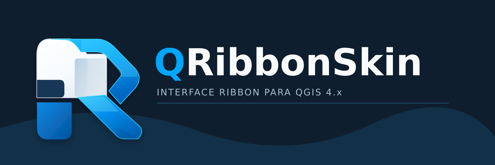

# QRibbonSkin

**Uma interface Ribbon para o QGIS 3.44 LTR e o QGIS 4.x, organizada a partir das ferramentas nativas do próprio QGIS.**

**Versão atual: 1.6.2.** Versões publicadas: [Releases](https://github.com/ezrandrade/QRibbonSkin/releases).

O **QRibbonSkin** oferece ao **QGIS 3.44 LTR** e ao **QGIS 4.x** uma interface Ribbon reversível com a **mesma disposição da Ribbon do RustGIS**, construída exclusivamente com comandos, menus, ícones e cores **nativos do QGIS**. Não substitui nem altera os algoritmos de geoprocessamento, não altera os dados cartográficos e preserva a **página inicial original do QGIS**.

> **Importante:** o QRibbonSkin é um projeto próprio. Os créditos relativos a referências e recursos derivados estão registrados em [ATTRIBUTION.md](ATTRIBUTION.md).

## Recursos

- Disposição do RustGIS: barra de acesso rápido (Novo, Abrir, Salvar, Desfazer, Refazer, Histórico) e **Buscar comandos** no topo; **Alt+Q** abre o Spotlight: um campo de busca centralizado na janela do QGIS, cujos resultados aparecem abaixo à medida que são encontrados; botão **Projeto** e as guias **Início, Dados, Estilo, Rotulagem, Editar, Analisar, Exibir, Publicar, Complementos, Configurações e Ajuda**; grupos rotulados com botões grandes (ícone 24 px) e pequenos (ícone 16 px, até três por coluna; um botão pequeno que ficaria sozinho na coluna é exibido como grande).
- Guias **Dados, Estilo e Rotulagem contextuais**: mostram ferramentas de vetor ou de raster conforme a camada selecionada no painel Camadas, como no RustGIS.
- **Recolher/expandir** a Ribbon pelo chevron, por duplo clique numa guia ou **Ctrl+F1**; com a Ribbon recolhida, clicar numa guia a exibe temporariamente.
- Setas de rolagem nas bordas quando a janela é estreita (também roda do mouse).
- **Somente objetos nativos**: cada botão reutiliza a QAction do próprio QGIS (ícone, tradução da dica, estado habilitado/marcado, atalho); os menus suspensos de Vetor, Raster, Banco de dados, Web, Malha, Processamento e Complementos são os **próprios menus do QGIS**, portanto entradas de complementos aparecem automaticamente, sem varredura.
- **Cores do tema ativo do QGIS** (inclusive temas escuros), também nos editores de Layout, Georreferenciador e Designer de Modelos; painéis do QGIS mantêm a aparência nativa.
- O botão **Projeto** mostra na própria Ribbon os comandos nativos de projeto (novo, abrir, recentes, modelos, armazenamento, layouts, importar/exportar, propriedades): a página inicial do QGIS não é substituída.
- Ícones grandes em 24 px e pequenos em 16 px, os tamanhos para os quais o tema do QGIS os desenha; alturas derivadas da fonte da interface.
- Atalhos de teclado nativos continuam funcionando com a barra de menus oculta.
- Sem redundâncias: dentro de uma guia nenhum comando aparece duas vezes (os menus nativos usados como botões suspensos omitem o que já tem botão na guia); entre guias, só comandos que servem ao trabalho de outra guia: as repetições que o RustGIS também faz (tabela de atributos, seleção por atributos/localização e Exibir › Janelas espelhando os painéis) e as ferramentas **Selecionar** e **Limpar seleção** na guia **Editar**, já que a edição age sobre as feições selecionadas. A guia Complementos mostra só o gerenciador e o conteúdo dos complementos instalados.
- Georreferenciador sempre visível na guia **Dados** (grupo Alinhamento).
- **Complementos**: o Gerenciador de complementos e, no grupo **Complementos instalados**, **um botão por complemento** (ícone e nome do complemento), para economizar espaço. Um complemento com um único comando o executa direto; com vários, o botão abre um menu com todas as suas funções (incluindo submenus, como os provedores do QuickMapServices) e, se a barra dele tiver controles que só funcionam nela, *Mostrar barra de ferramentas*. Os comandos vêm dos menus do QGIS em que o complemento se instalou (Complementos, Vetor, Raster, Banco de dados, Web, Malha, Processamento), de um menu próprio ou da sua barra, sem repetição. A guia é remontada apenas quando um complemento é instalado, ativado ou removido. Os comandos do próprio QGIS (incluindo os algoritmos do Processing) permanecem nas guias de origem; um complemento que nomeie seus comandos no padrão interno do QGIS (`mAction…`) seria tratado como comando do QGIS.
- Leve: sem temporizadores e sem filtros de eventos globais; janelas detectadas por sinais do QGIS, mudança de foco e criação de barras; guias montadas sob demanda.
- Retorno à interface clássica (Configurações → Interface clássica, ou Ctrl+Alt+Shift+R) e recuperação de barras e painéis.

Ícones: usados os do tema do QGIS (`QgsApplication.getThemeIcon`). Apenas três comandos sem equivalente no QGIS (Interface clássica, Mapa em foco e Recolher a Ribbon) usam ícones novos, desenhados na grade 24×24 e na paleta dos ícones do QGIS (`resources/icons/qgis_style`).

## Janelas de edição

O **Compositor de Layout**, o **Georreferenciador** e o **Designer de Modelos** recebem a mesma Ribbon da janela principal: mesmo componente, ícones nativos em 24 px, cores do tema do QGIS, Spotlight (**Alt+Q**) e a mesma regra contra redundâncias. Cada janela tem seu botão no estilo "Projeto" (**Layout**, **Arquivo**, **Modelo**).

- **Layout:** a guia Início segue os grupos de layout do RustGIS (Página, Quadros de mapa, Elementos de mapa, Formas, Texto e imagens, Exportar). Os botões de inserir itens vêm do registro de itens do QGIS e são classificados pelo tipo do item, com os nomes traduzidos pelo próprio QGIS. As guias **Atlas** e **Relatório** aparecem conforme o tipo de documento aberto.
- **Georreferenciador:** pontos de controle, transformação e navegação na guia Início; vínculo com o QGIS e realce em Exibir.
- **Designer de Modelos:** a ordem segue a barra do ModelBuilder do RustGIS (executar, editar, organizar, navegar).

As barras e menus originais de cada janela ficam apenas ocultos (**Configurações → Barras nativas** os mostra novamente) e são restaurados ao fechar a janela ou desativar o QRibbonSkin; nenhuma ação é removida delas e nenhum painel é estilizado.

**English:** the Layout Designer, Georeferencer and Model Designer share the main window's Ribbon component (native icons, theme colours, Alt+Q Spotlight). Native toolbars are only hidden and are restored on close; nothing is removed from them.

## Tabela de atributos

A **tabela de atributos** recebe a mesma Ribbon, com as guias **Início** (Edição, Feições, Área de transferência, Seleção, Mapa, Ações), **Campos** (Estrutura de dados, Exibição) e **Configurações**. Só aparecem os comandos que o QGIS deixa na barra da tabela para aquela camada (sem permissão de exclusão, por exemplo, *Excluir* e *Recortar* não aparecem), e o botão *Ações* só aparece quando a camada tem ações de feição. Os atalhos próprios da tabela (Ctrl+E, Ctrl+F, Del…) continuam funcionando.

Quando a tabela está **acoplada** à janela principal, a Ribbon começa recolhida (um clique numa guia a mostra) e Alt+Q/Ctrl+F1 ficam com a Ribbon principal, sem conflito de atalhos; ao desacoplar, volta expandida. A barra original da tabela fica apenas oculta (**Configurações → Barras nativas**) e é devolvida ao desativar o QRibbonSkin.

**English:** the attribute table gets the same Ribbon (floating or docked); only commands QGIS keeps on the table toolbar for the layer are shown, table shortcuts keep working, and the native toolbar is restored on exit.

## Resolução de tela

A resolução recomendada para melhor experiência de uso é **1920 × 1080 pixels (Full HD/1080p) ou superior**. O QRibbonSkin também funciona em resoluções inferiores, com maior necessidade de rolagem horizontal da Ribbon (setas nas bordas ou roda do mouse) e possibilidade de recolhê-la (**Ctrl+F1**). **A resolução de 800 × 600 pixels não é recomendada.** Trata-se de uma recomendação de ergonomia, não de um bloqueio técnico.

## Compatibilidade verificada

| Versão do QRibbonSkin | Sistema | QGIS | Resultado |
|---|---|---|---|
| 1.6.2 | Windows 11 26H2 | 4.2.2 | Homologado |
| 1.6.2 | Windows 11 26H2 | 3.44.15 LTR | Homologado |
| 1.6.2 | Ubuntu Linux 26.04 LTS | 4.2.2 | Homologado |
| 1.6.2 | Ubuntu Linux 26.04 LTS | 3.44.15 LTR | Homologado |
| 1.5.1 | Windows 11 26H2 | 4.2.2 | Homologado |
| 1.5.1 | Windows 11 26H2 | 3.44.15 LTR | Homologado |
| 1.5.1 | Ubuntu Linux 26.04 LTS | 4.2.2 | Homologado |
| 1.5.1 | Ubuntu Linux 26.04 LTS | 3.44.15 LTR | Homologado |
| 1.4.3 | Windows 11 | 4.2.x | Homologado |
| 1.4.3 | Ubuntu Linux (Flatpak) | 4.2.x | Homologado |
| 1.1.44 | Windows 10 | 4.0 | Homologado |
| 1.1.44 | Windows 11 26H2 | 4.2.2 | Homologado |
| 1.1.44 | Ubuntu Linux 26.04 (Flatpak) | 4.2.3 | Homologado |

A versão 1.4.3 não foi testada no Windows 10 com QGIS 4.0.

**QGIS 3.44 LTR (a partir da versão 1.5.0):** o mesmo código roda em Qt5/PyQt5 (QGIS 3.44) e Qt6/PyQt6 (QGIS 4.x); a versão 1.6.2 foi homologada no QGIS 3.44.15 LTR e no QGIS 4.2.2, em Windows 11 e Ubuntu 26.04 LTS. No 3.44, comandos que só existem no QGIS 4 (digitalização Bézier/NURBS, contagem de feições no Designer de Modelos) simplesmente não aparecem.

Essas validações foram comunicadas pelo responsável pelos testes; não constituem garantia de compatibilidade com todas as configurações do QGIS.

## Instalação

1. Abra **Complementos → Gerenciar e Instalar Complementos** no QGIS 3.44 LTR ou 4.x.
2. Escolha **Instalar a partir de ZIP** e selecione o arquivo distribuído.
3. Ative o QRibbonSkin. A opção de retorno à interface clássica fica na guia **Configurações**; o complemento também pode ser desativado pelo gerenciador de complementos.

## Utilização

Use a guia **Início** para navegar, adicionar dados, selecionar, medir e identificar; **Dados**, **Estilo** e **Rotulagem** para a camada selecionada; **Editar** para edição vetorial; **Analisar** para a Caixa de Ferramentas, o Designer de Modelos e os menus Vetor/Raster/Malha/Banco de dados; **Exibir** para painéis, decorações e vistas; **Publicar** para layouts, relatórios e exportação; **Complementos** para o gerenciador e um botão por complemento instalado.

## Contribuições e relato de problemas

O código-fonte está disponível neste repositório. Problemas de interface, incompatibilidades e sugestões de melhoria podem ser registrados em [Issues](https://github.com/ezrandrade/QRibbonSkin/issues). Ao relatar um problema, informe a versão do QGIS, o sistema operacional, a versão do complemento e os passos necessários para reproduzir a ocorrência.

## Autoria, atribuições e licença

**Autor do QRibbonSkin:** Esdras Andrade.

A arquitetura reversível de interface foi inspirada no ArcSkin, e a disposição da Ribbon segue a interface do RustGIS, sem cópia de código ou recursos; as referências estão discriminadas em [ATTRIBUTION.md](ATTRIBUTION.md). Desde a versão 1.3.1 o pacote não contém ícones derivados do ArcSkin: os ícones exibidos são os do tema do QGIS e três desenhos próprios no padrão QGIS. Essas atribuições não tornam as funcionalidades dos projetos equivalentes.

O QRibbonSkin é distribuído sob os termos da licença constante em [LICENSE](LICENSE) (**GNU GPL v2**).

---

**QRibbonSkin — interface reorganizada, ferramentas nativas do QGIS.**
